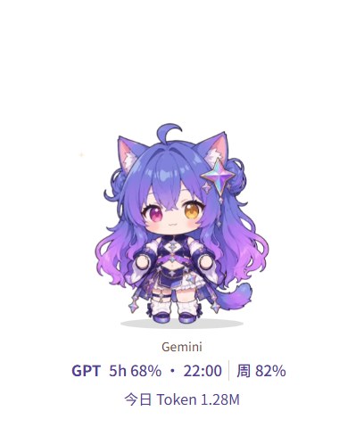
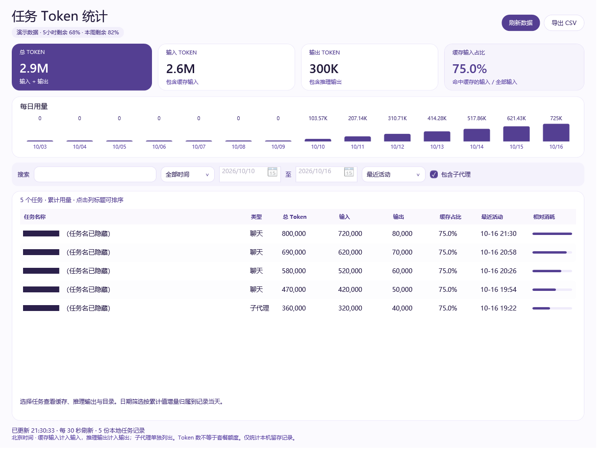
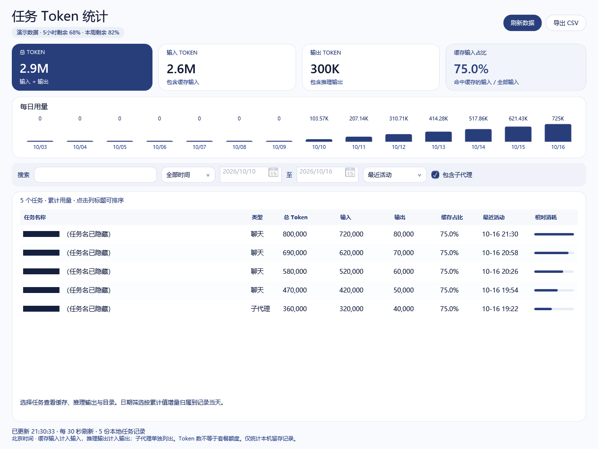

# CrossPet · Codex Usage

自由选择桌宠，在桌宠下方查看 Codex 剩余额度与今日 Token。

基于 [lokicorvus/crosspet](https://github.com/lokicorvus/crosspet) 的 Windows 定制版，合入任务 Token 统计窗口。角色选择与正在使用的 AI 分离，保留原有动作和互动。



## 功能

- 自由选择 Claude、DeepSeek、Gemini、GLM、GPT 及现有服装，保留摸头、拖动、贴边、节日和彩蛋。
- 桌宠底部固定显示 GPT 额度，放大字号，并显示北京时间今日 Token；没有额外用量卡片。
- 点击底部额度/Token，或右键选择“任务 Token 统计”，查看搜索、日期筛选、每日趋势、子代理和 CSV 导出。
- 统计窗口随当前宠物切换金色、蓝色、紫色、靛蓝或灰蓝主题，保留筛选与数据。
- 设置精简为外观、角色、通用；支持登录 Windows 后自动启动。

## 界面截图

以下均为实际程序界面使用虚构数据渲染的截图，所有任务名已遮挡，不包含真实聊天记录、个人目录或任务 ID。

Gemini 紫色主题：



DeepSeek 蓝色主题：



## 构建和运行

需要 Windows、.NET 8 SDK（或更新 SDK）、.NET Framework 4.8 和 Microsoft Edge WebView2 Runtime。

在项目根目录执行：

```powershell
powershell -ExecutionPolicy Bypass -File .\tools\build-merged-windows.ps1
```

然后运行 `桌宠用量合并版/CrossPet.exe`。额度读取需要本机已有已登录的 Codex。不需要向本项目提供密码或 API Key；额度和 Token 统计不依赖 Python。

原版 AI 工作事件仍需事先配置对应钩子。本定制版移除了接入设置页；如需原版接入脚本，可在构建时传入独立 conda 环境路径：

```powershell
.\tools\build-merged-windows.ps1 -PythonEnvironment '<独立 conda 环境目录>'
```

不要使用 conda base 环境。Python 目录联接只适用于本机，不能作为可移植 Python 包分发。

## 统计与隐私

只读取本机 CODEX_HOME（默认用户目录 .codex）内留存的会话与归档。累计快照取最高值，相同线程去重；缓存输入包含在输入中，推理输出包含在输出中。今日统计按北京时间正增量计算，包含子代理；记录缺失会导致结果不完整。Token 不是套餐余额或账单。

仓库不包含真实会话、任务标题、CSV、凭据及个人统计截图。分享统计截图时，请遮住任务名、目录和 ID，建议使用虚构演示数据。

## 验证

```powershell
node --test tests/*.test.js
dotnet run --project tests/windows/UsageMergeTests -- '<工作空间内的测试数据目录>'
```

JavaScript 测试覆盖文字缩放、额度排版等；Windows 检查覆盖会话去重、累计统计、北京时间日期和子代理。

## 代码结构

- `app/web`：桌宠画面、互动效果与设置页面，Windows 和 macOS 共用。
- `app/windows/src`：入口 `Program.cs`、配置与资源管理 `Store.cs`；其余源码按职责分组：`Pet`（桌宠与交互）、`Quota`（额度来源）、`Platform`（Windows 系统接口）、`Sprites`（立绘资源）、`Dialogs`（设置及辅助窗口）、`UsageViewer`（任务统计）。
- `app/windows/src/UsageViewer`：任务用量模块。`TaskUsageModels.cs` 定义数据，`TaskUsageStore.cs` 读取和缓存会话，`UsageMetrics.cs` 统一日期筛选、汇总与数字格式，`TaskUsageWindow.cs` 负责界面。
- `app/mac`：macOS 外壳；`integrations`：各 AI 的事件钩子；`characters`：角色及素材。
- `tools`：构建与素材工具，见[工具导航](tools/README.md)；`tests`：回归检查；`docs`：设计、来源及使用说明，见[文档导航](docs/README.md)。

底栏、任务列表和趋势图共用用量计算逻辑。构建入口仍为 `tools/build-merged-windows.ps1`；临时验证文件放在忽略提交的 `.task-*` 专用目录。

## 来源与许可

- 原项目：[CrossPet](https://github.com/lokicorvus/crosspet)，保留原作者署名、版权和角色素材许可。[原版说明](docs/UPSTREAM_README.md)。
- 统计解析、窗口及主题由本地 CodexUsageViewer 2.1.1 源码整合，改为同一进程并共享扫描缓存。
- 源码采用 [MIT](LICENSE)。角色立绘、设定、图片和提示词采用 [CC BY-NC-SA 4.0](characters/LICENSE.md)，须署名、不得商用，衍生素材采用相同许可。

这是非官方定制版。上游自动更新会覆盖定制功能，请以本仓库源码构建为准。
